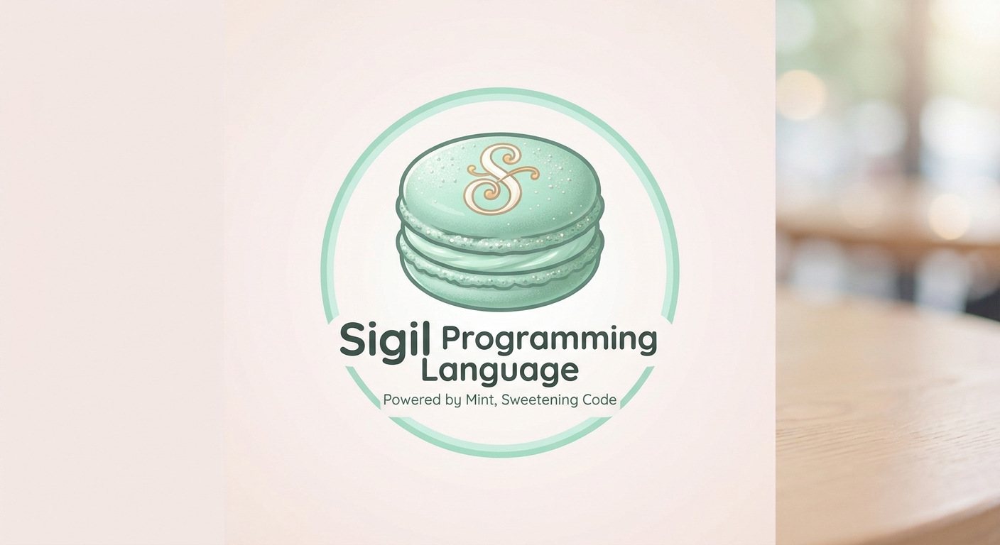

<div align="center">
  <!-- 💚 お手持ちのロゴ画像をリポジトリにアップロード後、srcのパスを書き換えてください -->
  

  <h1>💚 Sigil Programming Language ✨</h1>

  <p><i>"Powered by Mint, Sweetening Code."</i></p>

  
  
  
</div>

---

### 🍵 ようこそ、Sigilの世界へ！
**Sigil**は、あの愛らしい緑のちいさな相棒がフォースで引き寄せた**お気に入りのミントマカロン**のように、ひとくちで心をときめかせる**心地よさと美しさ**を大切にした新しいプログラミング言語です。

コードを書く時間が、もっと楽しく、もっとあなたらしくなるように。魔法の印（Sigil）を紡ぐように、お気に入りのロジックをデザインしてみませんか？

---

## 🎀 3つのときめきポイント (Features)

* **ミント・セーフティ (Refreshing Safety)**
  爽快でタフな静的型チェック。バグを事前に優しくキャッチし、あなたの開発ライフの安心をフォースのようにそっと守ります。

* **マカロン・シンタックス (Sweet Syntax)**
  甘くてシンプル。無駄な記号をそぎ落とし、まるで可愛いブログのダイアリーを読んでいるかのように滑らかに頭に入ってくるコードデザインです。

* **パステル・エコシステム (Pure & Light Ecosystem)**
  余計なものは一切なし。ピュアで軽量なコアランタイムにより、どんな環境でもサクサクと軽快に動き出します。

---

## 🎨 コードのぞき見 (Hello, Sigil!)

まずは一番シンプルな魔法を使ってみましょう。爽やかなミントミルクのように優しいコードの佇まいを感じてください。

```sigil
// 💚 はじめての魔法
cast spell invocation() {
    let greeting = "Hello, Sweet Mint World!"
    print(greeting)
}

invocation()
```

---

## 🚀 はじめかた (Quick Start)

あなたのお手元の環境に、またたく間にSigilをインストールできます。

### 1. 魔法陣の準備 (Installation)
ターミナルを開いて、以下のコマンドをそっと実行してください。

```bash
curl -fsSL https://sigil-lang.org | sh
```

### 2. スクリプトの実行 (Run Your First Spell)
拡張子 `.sigil` のファイルを作ったら、いよいよ起動です。

```bash
sigil run welcome.sigil
```

---

## 🍰 カラーパレットと世界観 (Design Identity)

Sigilのコミュニティやツールチェーンは、以下の**ミント＆マカロンパステル**な世界観で統一されています。

| カラー名 | カラーコード | 役割 |
| :--- | :--- | :--- |
| **Nevarro Mint** | `#BFE3DB` | メインアクセント・キーワード（グローグーのマカロン色） |
| **Macaron Pink** | `#FFD1DC` | サブアクセント・型名 |
| **Lemon Yellow** | `#FFFFBA` | ストリング・リテラル |
| **Lavender Spell** | `#E8DCFA` | 関数名・ビルトイン魔法 |

---

## 🤝 一緒にお茶しませんか？ (Contributing)

Sigilはみんなで育てるオープンソースの秘密基地です。
「このシンタックスをもっと可愛くしたい！」「このエラーメッセージを優しくしたい！」といったアイデアがあれば、いつでもお気軽に Pull Request や Issue を投げてくださいね。

1. このリポジトリを **Fork** する 🍴
2. あなたのアイデアを **Branch** にまとめる 🌿
3. 楽しんでコードを書き、**Pull Request** を送る 🎉

---

<div align="center">
  <p>Made with 💚 and a cup of mint tea.</p>
  <p>Copyright © 2026 Sigil Core Team. Licensed under the MIT License.</p>
</div>


---

# Sigil

**人間に代わって AI がコーディングするための開発言語。**

Sigil（シジル）は、Java・React・Node.js に代わる言語を目指して開発する、AI 専用の汎用プログラミング言語です。
コードは AI が書き、AI が保守します。人間は **仕様だけ** をレビューします。

> **ステータス:** 設計段階が中心で、処理系（Rust 製）は M0〜M6 まで実装済みで、P0（言語の核）は完了しました。M5 では `sigil build` が単一の静的な実行ファイル（Linux x86-64）を出力し、インタプリタと同じ結果になることをテストで確かめています（[ADR 0015](docs/decisions/0015-m5-native-output.md)）。M0 は構文解析・`sigil fmt`・`sigil spec`、M1 は型検査と効果の検査（標準ライブラリは仮の最小範囲 `src/stdlib.rs`）、M2 は所有権・借用の検査（移動・借用・クロージャのとらえ方・篩型の借用・契約の式の規則・関数の値の移動・借用区間の部品 `src/borrow.rs`）で、5 つの例が `sigil check` を通ります。M3・M4 は標準ライブラリ・効果操作を備えた実行系で、`sigil run` は SIR の評価器で動きます（インタプリタはテストで結果を突き合わせる役に退きました。[ADR 0017](docs/decisions/0017-run-on-sir-evaluator.md)）、M5 は Cranelift によるネイティブ出力です。`sigil spec` は表示だけで、`trust base` の許可（`--trust-base`）は検査しません。`sigil spec --json <ファイル>` は仕様を構造の欄と日本語の定型文（`text`）の JSON で、`sigil check --json <ファイル>...` は診断を JSON（`kind`・`phase`・位置・`message`）で出します（[ADR 0019](docs/decisions/0019-m6-machine-spec-and-language-server.md) の PR1。JSON は依存を足さず自前の `src/json.rs`）。読めないファイルは `--json` では `ReadError` の診断（`phase` は `read`、位置は `null`）になります。`sigil lsp [--trust-base <モジュール>]...` は標準入出力で話す言語サーバーで、`didOpen`・`didChange` のたびに `sigil check` と同じ検査をして診断（`publishDiagnostics`）を返します（ADR 0019 の PR2。依存は足さず自前の `src/lsp.rs`）。関数・メソッドの宣言、同じモジュールの関数・`Type.method(...)` の呼び出し、型の宣言の名前にカーソルを置くと、`sigil spec` と同じ仕様を hover（`textDocument/hover`、平文）で返します（PR3。`src/lsp/hover.rs`。名前は構文だけで引くので、型の誤りがあっても動きます）。
> P0（言語の核）の実装の進め方（Rust で書くコンパイラ、段階 M0〜M6）を [ADR 0006](docs/decisions/0006-p0-scope-and-bootstrap.md) で決めました。
> 並行処理のモデル（中断を効果として扱う構造化並行処理）を [ADR 0007](docs/decisions/0007-concurrency-model.md) で決めました。
> M0 の前に決める表記（`old`・篩型・モジュールの宣言・`sigil spec` の出力など）を [ADR 0008](docs/decisions/0008-m0-notation.md) で決めました。
> 字句と文法の全体仕様（コメント・識別子・予約語・リテラル・演算子の優先順位・正規形）を [ADR 0009](docs/decisions/0009-lexical-and-grammar.md) で決めました。
> `sigil fmt` の仕様と M0 の補足を [ADR 0010](docs/decisions/0010-fmt-and-m0-addendum.md) で、型システムの範囲（所有権と借用の表記、型引数、篩型、関数の値の制限など）を [ADR 0011](docs/decisions/0011-type-system-scope.md) で決めました。
> 所有権の検査の細目と標準ライブラリの規則を [ADR 0012](docs/decisions/0012-ownership-check-and-stdlib.md) で、M3 の前に決める論点（停止を効果に数えないこと、標準ライブラリの正式な一覧、関数の値の渡し方、借用区間の部品）を [ADR 0013](docs/decisions/0013-termination-stdlib-and-function-values.md) で決めました。
> `sigil run` を SIR の評価器に載せ替える決定（`--trace-drops` の追加を含む）を [ADR 0017](docs/decisions/0017-run-on-sir-evaluator.md) で決めました。
> 信頼基盤の宣言方法と検査を外した箇所の契約の書き方を [ADR 0016](docs/decisions/0016-trust-base-declaration.md) で決めました（実装済み。`sigil check`・`run`・`build` の `--trust-base <モジュール>` が許可）。
> 標準ライブラリの核と OS 依存部分の分割（出力先 `bare`、層ごとの標準ライブラリの表、核のモジュールからの OS 層の参照の検査）を [ADR 0014](docs/decisions/0014-core-and-os-split.md) で決めました。

## 目標

- **AI が書き手**: 人間の書きやすさではなく、AI が意図を曖昧さなく表現でき、誤りを機械的に検出できることを優先します。
- **人間は仕様だけを見る**: 意図・事前条件・事後条件・効果をコードから取り出して人間に示し、コードがそれを満たすことを処理系が検証します。
- **フロントエンドからバックエンドまで 1 言語**: ブラウザの UI（React の置き換え）、サーバー（Java・Node.js の置き換え）、その間の通信を同じ言語で書きます。
- **独自の実行方式**: コンパイラと実行環境を独自に作ります。サーバー向けにはネイティブコード、ブラウザ向けには WebAssembly と JavaScript を出力する想定です。
- **Python から呼び出せる**: Sigil で書いた関数・型を Python から呼び出せるようにします。
- **Rust と同等のメモリ安全性**: 解放後の使用・ヌル参照・データ競合などのメモリ不具合を、コンパイル時に排除します。

決定の経緯は [docs/decisions/0001-vision-and-scope.md](docs/decisions/0001-vision-and-scope.md) を参照してください。

## 長期目標

最終的には、Sigil で次のものを置き換えられるようにすることを目指します（[ADR 0005](docs/decisions/0005-long-term-goals.md)）。

- Next.js（フロントエンドとサーバーを一体で書く Web フレームワーク）
- Spring（Java のサーバーアプリケーション用フレームワーク）
- Python
- データベース
- Git（ソースを管理するリポジトリ管理）
- サービスを Docker コンテナで動く形にしてリリースする仕組み、さらにコンテナを管理する仕組み
- OS（VMware ESXi 上の仮想マシンで動く OS を含む）
- IDE（統合開発環境）: 人間には仕様をレビューする場、AI にはコードを書くための道具を提供する
- Web ブラウザ

進める順序:

| 段階 | 内容 |
|---|---|
| P0 | 言語の核（コンパイラ・検査・仕様の表示・標準ライブラリの最小部分・言語サーバー）。**完了**（M6、2026-10-26） |
| P1 | サーバー（Spring の置き換え）と Docker コンテナでのリリース |
| P2 | Web フルスタック（Java・React・Node.js・Next.js の置き換え）と IDE |
| P3 | Python の置き換えと Python 連携 |
| P4 | データベース・リポジトリ管理（Sigil で書くアプリケーション） |
| P5 | コンテナ管理 |
| P6 | OS（ESXi 上の仮想マシンを含む） |
| P7 | ブラウザ（P2 の後、P3〜P6 と並行して進められる） |

## 設計の柱（草案）

1. **仕様の明示**: 関数や単位ごとに、意図・前提・事後条件・効果を一級の構文として書く。
2. **機械的検証**: 型・所有権・契約・効果の検査で、誤りを実行前に検出する。
3. **決定的な表現**: 同じ意味を複数の書き方で表せないようにする（正規化可能な構文）。
4. **人間の可読性より検証可能性**: 人間が読むのは仕様であり、コード本体の読みやすさは優先しない。

詳細は [docs/DESIGN.md](docs/DESIGN.md) を参照してください。

## リポジトリ構成

```
.
├── README.md          このファイル
├── LICENSE            MIT License
├── docs/
│   ├── DESIGN.md      言語設計の全体像（草案）
│   └── decisions/     設計判断の記録（ADR）
└── examples/          サンプルコード（構文の検討用）
```

## ライセンス

MIT License。詳細は [LICENSE](LICENSE) を参照してください。
