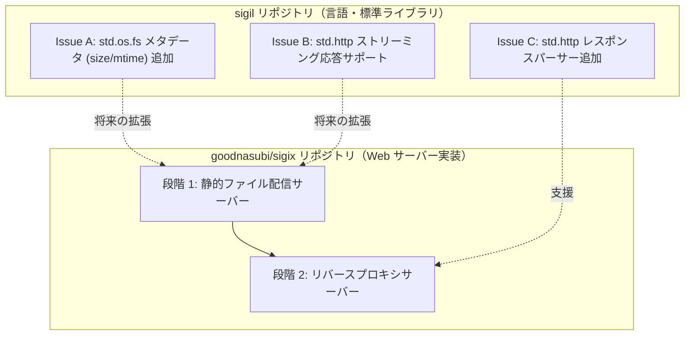

# 0056: sigix: Web サーバー（段階 1 静的配信・段階 2 リバースプロキシ）

- **状態**: 提案（予約: Issue #647。主要 4 論点 q1〜q4 は typesafe-ai 正式判定済。レビュー対応中）
- **日付**: 2026-11-22（JST）
- **対象**: [Issue #647](https://github.com/goodnasubi/sigil/issues/647)、レーン E
- **仕様基準**: sigil の `main`、`809af3e88ba6ce16b0b70372fa9caab3e0be45e8`
- **範囲**: ADR の起草のみ。実装リポジトリは `goodnasubi/sigix`（ADR 0044 決定 4 のパターン）。本リポジトリ（`sigil`）のコンパイラ・標準ライブラリのコード変更は含めない（言語・標準ライブラリへの追加要求は別 Issue として扱う）

---

## 背景と前提

所有者の構想（2026-11-21）に基づき、Sigil 製の nginx 風 Web サーバー **sigix** を Sigil の実アプリケーションとして開発する。進め方は所有者により決定済みで、段階 1 で静的ファイル配信、段階 2 でリバースプロキシを実装する「段階的に両方」とする。

仕様は `sigil` リポジトリの ADR として起草・管理し、実装は独立したリポジトリ `goodnasubi/sigix` に置く（[ADR 0044](0044-p4-scope.md) 決定 4 のパターン）。

### 既に決まっている前提事項

1. **名前と置き場所**:
   - 製品名は `sigix`、実装リポジトリは `goodnasubi/sigix`。仕様は本 ADR。
2. **進め方**:
   - 段階 1 = 静的ファイル配信 → 段階 2 = リバースプロキシ（所有者決定）。
3. **TLS の扱い**:
   - sigix 本体には TLS 終端を持たせず、専用の TLS 終端部品を前段に置く（typesafe-ai 正式判定済: jev-1.13.0、2026-11-21、B 案の確率 0.95、confidence 0.92）。[ADR 0018](0018-p1-scope.md) 判断 5・[ADR 0032](0032-p1-http-server.md) の前提（TLS は実装せず前段で終端）と整合する。
   - sigix は平文 HTTP のみを受け付け、前段終端部品と sigix の間の平文区間は**同一ホスト内（ループバックアドレス `127.0.0.1` / `::1`）または安全に隔離された内部ネットワークに限定**する。
4. **土台（既存の標準ライブラリ基盤）**:
   - TCP 待ち受け: `net.listen`（[ADR 0031](0031-p1-first-wait-ops-and-socket-api.md)、[ADR 0051](0051-ipv6-listen.md) の IPv6 数値アドレス受け付けを含む）
   - HTTP/1.1 サーバー: `std.http`（[ADR 0032](0032-p1-http-server.md)）
   - 上流接続: `net.connect` / `TcpClient`（[ADR 0034](0034-p1-postgresql-client.md)）
   - ファイル境界: `Dir` 起点、`..` 脱出拒否・symlink 追従拒否（[ADR 0049](0049-common-fs-boundary.md) 決定 1・2・4）
   - 上限管理: `HttpLimits`（[ADR 0020](0020-p1-security-addendum.md) 決定 4）
5. **範囲外として確定**:
   - HTTP 応答の gzip 圧縮（[ADR 0052](0052-compression-contract.md) が提供しないと明記）。
   - DNS による動的な名前解決（[ADR 0031](0031-p1-first-wait-ops-and-socket-api.md) 決定 3。バックエンドの指定は数値 IP アドレス＋ポート番号を前提とする）。

---

## 現状の確認（仕様基準で確認）

起草にあたり、仕様基準のコミットにおいて実物コードベースを確認した事実は次のとおりである。

1. **HTTP 基盤（`src/stdlib/http.sigil`）**:
   - `http.serve_conn` のハンドラ型は `h: fn(&HttpRequest) -> HttpResponse` であり、リクエストごとに同期的に `HttpResponse` を返す。
   - `HttpResponse` は `body: Bytes` を値として保持し、現行の `std.http` にはストリーミング応答やチャンク転送（chunked encoding）を逐次書き出す API は存在しない。
   - `HttpParser` は受信したリクエストを解釈するが、**HTTP レスポンス（上流からの応答）を解釈する公開パーサーは `std.http` に存在しない**。
2. **ファイルシステム境界とファイル読み込み（`src/stdlib/os_fs.sigil`・`src/stdlib.rs`）**:
   - `fs.open_dir(p)` から得られる `Dir` は `open_file(subpath, options)` を持ち、内部で `newfstatat` に `AT_SYMLINK_NOFOLLOW` を指定して symlink 追従を拒否し、パス正規化で親ディレクトリへの脱出を拒絶する（ADR 0049）。
   - ファイルの読み込み API として、現行の `std.os.fs` には上限バイト数を指定して読む **`fs.read_bytes(p: &Path, max: Int) -> Result<Bytes, BinaryIoError>`** が存在する（内部で `fstat` によりサイズを検査し、`max` 超過時は全量を読まずに即座に `BinaryIoError.TooLarge` を返す）。
   - 一方で、`Dir` 起点のファイル境界ハンドル `File`（`open_file` 経由）および `DirEntry` の公開 API には、**ファイルのサイズ（st_size）や最終更新日時（st_mtime）を取得する公開関数が存在しない**（`File.read` / `File.read_at` は渡されたバッファ長を上限とする読み出しのみを提供し、`File` 向けの上限指定一括読出し API は未提供）。
3. **設定とシグナル（`src/effects.rs`・`src/stdlib/os_env.sigil`）**:
   - 環境変数の取得 `env.get` は利用可能（効果 `env`）。
   - `signalfd` や任意のシグナル捕捉（SIGHUP など）による非同期ホットリロード機構は未提供である。

---

## 決定事項（未決定事項 6 点の判断と根拠）

| # | 論点 | 採用する案 | 根拠と他案を採らない理由 |
|---|---|---|---|
| 1 | **段階表上の位置づけ** | P1 系アプリケーションの実践・発展（非ブロッキング、**typesafe-ai 正式判定済**） | ADR 0005 決定 2 の P0〜P6 コア段階の順序を変更せず、P1 のサーバー基盤・コンテナ配備と ADR 0049 の fs 境界の上で動く別リポジトリアプリケーションとして進める。言語の依存鎖（P4→P5→P6）を阻害しない。 |
| 2 | **設定の持ち方と再読み込み** | 段階 1 は CLI 引数・環境変数、段階 2 で JSON 設定併用。再読み込みはプロセス再起動のみ | 独自構文のパーサー導入は脆弱性の温床になり、Sigil スクリプトの実行時評価は静的安全性を崩す。Sigil には SIGHUP 等の安全な非同期シグナル駆動機構が未整備であり、コンテナ環境（K8s / Docker）のローリング更新・再起動前提の運用が最も堅牢。 |
| 3 | **ディレクトリ応答** | `index.html` があれば 200 返却。無ければ 404 返却（**typesafe-ai 正式判定済**）。末尾 `/` なしは 301 リダイレクト、ファイルへの末尾 `/` 要求は 404（判定対象外（本 ADR で追記）） | 403 Forbidden は攻撃者にディレクトリの存在を暴露する情報漏洩（存在偵察）につながる。安全側に倒し（fail-closed）404 で遮断する。autoindex（ディレクトリ一覧）は提供しない。301 による限定的な存在露出は URL 正規化を優先し許容。 |
| 4 | **大きなファイルの扱い** | `HttpLimits` 上限（既定 1 MiB、設定時最大 64 MiB）超過時は安全な 500 返却（判定対象外（本 ADR で追記・提案））。ストリーミング応答は言語側別 Issue へ切り出し | `HttpResponse` が本文を `Bytes` でメモリ保持する現行仕様上、sigix 側だけで段階的読み出し（ストリーミング）を実装することは不可能。標準ライブラリの既定値 `response_body()`（1 MiB）を超え 64 MiB までの静的ファイルを扱う場合は `with_response_body` で上限を引き上げる。上限超過時は現行 `fs.read_bytes` の検知等で 500 で遮断し、事前サイズ検査と本格ストリーミングは言語側に要求する。 |
| 5 | **条件付き GET** | (b) 段階 1 の範囲からは見送り、(c) 言語側へファイルメタデータ API 追加を別 Issue で要求（**typesafe-ai 正式判定済**） | 現行 `std.os.fs` にサイズ・更新時刻の公開 API が無く、毎回全量ハッシュ計算を行うのは I/O・CPU 資源の浪費。API 追加後に段階 1 拡張または段階 2 で ETag / 304 を導入する。 |
| 6 | **段階 2 の転送方式** | (b) 要求を解釈し、応答も解釈して組み直す方式を採用（**typesafe-ai 正式判定済**。X-Forwarded-* 信頼境界や hop-by-hop 剥離規則は判定対象外（本 ADR で追記）） | ホップバイホップヘッダ（`Trailer` 等）の確実な剥離、Host 書き換え、X-Forwarded-* 付与、リクエストスマグリング防止、静的配信との同一ポート・経路別併用には構造的解釈が必須。応答解釈器は言語側への追加要求または sigix 内部パーサーで賄う。 |

---

### 決定 1: 段階表上の位置づけ（typesafe-ai 正式判定済）

- **位置づけ**: ADR 0005 決定 2 のコアコンパイラ段階（P0〜P6）の新しい段階とするのではなく、**P1 系アプリケーションの実践・発展**として位置づける（typesafe-ai 正式判定済: q1 `p1_app` 確率 0.95, confidence 0.90）。
- **実装リポジトリ**: `goodnasubi/sigix`（ADR 0044 決定 4 のパターンに準じ、仕様 ADR は本リポジトリ、実装は独立リポジトリ）。
- **根拠**:
  - P4（データベース・Git）・P5（コンテナ管理）・P6（OS 本体）は言語機能と処理系を直接拡張する最長の依存鎖を形成している。
  - sigix は P1 の成果物（HTTP/1.1 サーバー `std.http`、接続 `net.connect`、上限 `HttpLimits`）および ADR 0049（fs 境界）の利用側実証アプリケーションであり、コア依存鎖を止めずに並行して開発・検証できる。

### 決定 2: 設定の持ち方と再読み込み

1. **設定の形式**:
   - **段階 1（静的配信）**: 起動引数（CLI オプション）および環境変数（`env.get`）で指定する。
     - 待ち受けアドレス・ポート（既定値: `127.0.0.1:8080`、CLI 例: `--listen 127.0.0.1:8080`、環境変数 `SIGIX_LISTEN`。前段 TLS 終端からのループバック接続に限定することを既定とし、隔離された内部ネットワーク等で前段と別ホストになる場合のみ明示的に `--listen 0.0.0.0:8080` などのバインドを指定する）
     - 公開ドキュメントルート（例: `--root /var/www/html`、環境変数 `SIGIX_ROOT`）
     - ログ形式・上限設定（`HttpLimits` 項目への上書き、例: `--max-response-body 67108864`）
   - **段階 2（リバースプロキシ）**: 複数経路（パスプレフィックス）や複数バックエンドの割り当てが必要となるため、**JSON 形式の設定ファイル**（例: `/etc/sigix/config.json`）の読み込みをサポートする。
     - 解析には `std.json`（深さ上限 64、ADR 0033 決定 2）を使用し、未知キーや型不一致、範囲外値は起動時に即座に拒否（fail-closed）する。
2. **再読み込みの仕組み**:
   - **プロセス再起動のみ（restart-only）** とする。
   - **根拠**:
     - Sigil ランタイムおよび標準ライブラリには、任意のシグナル（SIGHUP 等）を安全に捕捉してイベントループ内で非同期に設定を再読み込みし、接続を段階的に引き継ぐ機構が存在しない。
     - コンテナ環境（Docker / Kubernetes）や systemd においては、プロセスの再起動によるローリングアップデートが標準的であり、実行中の設定再読み込みによる競合状態やリソースリークの危険を完全に排除できる。

### 決定 3: ディレクトリ要求への応答（typesafe-ai 正式判定済）

- **判定結果**: typesafe-ai 正式判定済（q2 `status_404` 確率 0.91, confidence 0.86）に基づき採用確定。

1. **`index.html` の自動返却**:
   - 要求されたパスがディレクトリを指す場合（例: `/` または `/assets/`）、そのディレクトリ直下に `index.html` が存在すれば、ステータス `200 OK`、`Content-Type: text/html; charset=utf-8` でその内容を返す。
2. **`index.html` が存在しない場合**:
   - **`404 Not Found`** を返す。
   - **根拠**: `403 Forbidden` を返すと、外部の攻撃者に対して「そのディレクトリが存在する」という内部構造情報を暴露（存在偵察）してしまう。ファイルが存在しない場合と同じ 404 を返すことで、情報漏洩を防ぎ安全側に倒す（fail-closed）。
   - ディレクトリ内のファイル一覧表示（autoindex）は**提供しない**（攻撃者へのファイル一覧露出防止）。
3. **末尾スラッシュのないディレクトリ要求の扱い（判定対象外（本 ADR で追記））**:
   - ディレクトリであるパスに対して末尾スラッシュなしで要求が来た場合（例: `/docs` がディレクトリを指す場合）、**`301 Moved Permanently` で末尾スラッシュ付きの正規化パス（`Location: /docs/`）へリダイレクト**する。
   - **根拠**: 相対パス解決の曖昧性を排除し、ブラウザのキャッシュおよびリンク解決を正しく機能させるため。
   - **301 と存在の隠蔽の関係（許容の根拠、判定対象外（本 ADR で追記））**:
     - `index.html` が存在しないディレクトリへの要求を 404 にする根拠は「ディレクトリの存在偵察を防ぐ（存在隠蔽）」ことにある。一方、末尾スラッシュ無しの要求（例: `/docs`）に対してディレクトリが存在する場合に 301（`Location: /docs/`）を返すと、存在しないパス（404）と区別でき、攻撃者に「`docs` というディレクトリが存在する」ことが推測されうる（その後の `/docs/` は 404 となる）。
     - しかし、正規のクライアントやブラウザによる相対リンク解決と URL 正規化の標準的動作を保つ実用性を優先し、この限定的な存在推測リスクはトレードオフとして**許容する**。
4. **ファイルに対する末尾スラッシュ要求の扱い（判定対象外（本 ADR で追記））**:
   - 通常ファイル（例: `a.txt`）に対して末尾スラッシュを付与した要求（例: `GET /a.txt/`）は、構文上はディレクトリ要求として第 1 防衛線を通過するが、ファイルシステム探索において通常ファイルに遭遇した段階で **`404 Not Found`** を返す（400 Bad Request にはしない）。

### 決定 4: 大きなファイルの扱いとエラー応答（判定対象外（本 ADR で追記・提案））

1. **応答本文の上限（判定対象外（本 ADR で追記））**:
   - 標準ライブラリ `HttpLimits`（ADR 0020 決定 4、`src/stdlib/http_limits.sigil`）の規定に従う。
   - `HttpLimits` の応答本文フィールド名は `lim_response_body`、値の参照アクセサは `response_body()`、更新アクセサは `with_response_body(v)`（`requires 1 <= v && v <= 67108864`）である。
   - 既定値は標準ライブラリに従い **1 MiB（1,048,576 バイト）** とする。
   - 1 MiB を超える静的ファイルの配信を行う場合は、起動時設定（CLI 引数 `--max-response-body` 等）により `with_response_body(v)` を呼び出して上限を引き上げる（最大 64 MiB = 67,108,864 バイトまで設定可能）。
2. **上限超過時のエラー応答と検査時期（判定対象外（本 ADR で追記））**:
   - 静的ファイルのサイズが設定された `response_body()` の上限を超える場合、ファイルの内容を全量読み込まず、**ステータス `500 Internal Server Error`**（定型エラー本文、内部パスや実サイズを含まない）を返す。
   - **現行 API と検査方式の選択**:
     - 現行の `std.os.fs` には上限バイト数を渡して読む API として **`fs.read_bytes(p: &Path, max: Int) -> Result<Bytes, BinaryIoError>`** が存在し、ファイルサイズが `max` を超過している場合は全量を読み込まず直ちに `BinaryIoError.TooLarge` を返す。これを利用する場合は上限検知時に安全に 500 を返却する。
     - ADR 0049 の `Dir` 起点サンドボックス（`Dir.open_file`）経由の `File` ハンドルを利用する場合は、現行 `File` に事前サイズ取得 API（`File.byte_len`）が存在しないため、`File.read` による固定バッファ（チャンク）単位での読み込みで上限超過を検知して中断するか、あるいは**段階 1 の実装を言語側 Issue A（`File.byte_len`）の完了後に着手する**こととし、Issue A 完了後はオープン直後に事前サイズ検査を行って超過時はファイル内容の読み込み自体を行わずに直ちに 500 を返す。
   - **根拠**: 巨大なファイルを不用意にメモリへ読み込むことによる OOM（メモリ枯渇 DoS）を構造的に防止する。413（Payload Too Large）はクライアントからのリクエスト本文に対するステータスであるため、サーバー都合で配信できないファイルに対しては 500 で安全に遮断する。
3. **ストリーミング応答の扱い**:
   - 現行の `std.http.HttpResponse` は本文全体を単一の `Bytes` としてメモリに保持する仕様であり、sigix アプリケーション層の工夫だけでストリーミング応答（chunked 転送やソケットへの逐次書き出し）を実現することは不可能である。
   - したがって、**本格的なストリーミング応答は言語／標準ライブラリ側の別 Issue（新規起票: Issue B `std.http` におけるストリーミングレスポンス・逐次書き込み API のサポート）として切り出す**。
   - sigix の初版（段階 1）は `HttpLimits.response_body()` の上限（最大 64 MiB）内に収まる一括読み込み・一括返却で完了とし、言語側にストリーミング API が整備された段階で sigix に取り込む。

### 決定 5: 条件付き GET（ETag / Last-Modified、typesafe-ai 正式判定済）

- **判定結果**: typesafe-ai 正式判定済（q3 `defer_and_request_api` 確率 0.94, confidence 0.91）に基づき採用確定。

1. **決定**:
   - **(b) 段階 1 の範囲からは見送る。**
   - **(c) 言語側（`sigil` リポジトリ）へファイルメタデータ取得 API の追加を別 Issue として求める。**
2. **根拠**:
   - `src/stdlib/os_fs.sigil` の実物を調査した結果、`File` や `Dir` からファイルのサイズ（`st_size`）や最終更新時刻（`st_mtime`）を取得する公開 API は提供されていない（内部システムコール `fstat` / `newfstatat` で `st_mode` のみチェックしている）。
   - ファイルメタデータ API が無い状態で ETag を生成しようとすると、リクエストごとにファイル全量を読み込んで SHA-256 を計算する必要が生じ、ディスク I/O および CPU 資源の浪費となる。また Last-Modified の生成は不可能である。
   - したがって段階 1 では条件付き GET は実装せず、言語側に `File.byte_len` および `File.mtime`（または `fs.metadata`）の公開 API 追加を求める Issue を起草し、API 導入後に段階 1 拡張または段階 2 で条件付き GET（`If-None-Match` / `If-Modified-Since`、304 応答）を導入する。

### 決定 6: 段階 2 の転送方式とリバースプロキシ仕様（typesafe-ai 正式判定済）

- **判定結果**: typesafe-ai 正式判定済（q4 `parse_and_reconstruct` 確率 0.82, confidence 0.64）に基づき採用確定。

1. **転送方式の決定**:
   - **(b) 要求を解釈し、応答も解釈して組み直す方式を採用する。**
   - **根拠**:
     - 単純なバイトスルー中継（TCP レベルまたは非解釈中継）では、ホップバイホップヘッダの剥離、`Host` ヘッダの書き換え、`X-Forwarded-For` / `X-Forwarded-Proto` の正規な挿入が行えず、セキュリティ境界として機能しない。
     - HTTP リクエストスマグリング（Smuggling）やスプリッティング攻撃を防ぐには、受信した要求をパーサーで検証・正規化し、安全なリクエストとして上流へ再構築して送信する必要がある。
     - 同一ポートで静的配信経路とプロキシ経路を併用するには、HTTP リクエストのパスを解釈してディスパッチすることが不可欠である。
2. **レスポンスパーサーの扱い**:
   - `std.http` には現状レスポンスパーサーが存在しないため、言語側へ `std.http.HttpResponseParser` の追加を求める Issue を起草するか、段階 2 実装時に sigix 内で最小限の HTTP/1.1 レスポンスパーサーを実装する。
3. **ヘッダの書き換え仕様**:
   - `Host`: 設定により「クライアントの要求 Host を保持（既定）」または「転送先バックエンドのホスト名へ書き換え」を選択可能とする。
   - `X-Forwarded-*` の信頼方針と付与規則（判定対象外（本 ADR で追記））:
     - **信頼境界**: 信頼する接続元（CIDR/IP 許可リスト、既定値は loopback `127.0.0.1` / `::1`）を設定で指定可能とする。接続元が許可リストに含まれる場合のみ前段から渡された `X-Forwarded-*` を信頼する。非 loopback かつ許可リスト外の接続元（直接接続の外部クライアント等）からの接続の場合は、送られてきた `X-Forwarded-*` ヘッダをすべて破棄し、偽装を防止するため接続元 IP で常に上書き（新規設定）する。
     - `X-Forwarded-For`: 信頼する接続元からの場合は前段の値を信頼し、直前のクライアント IP をカンマ区切りで追記（append）する。許可リスト外からの直接接続（またはヘッダ未設定）の場合は接続元 IP で上書き（新規設定）する。
     - `X-Forwarded-Proto`: 信頼する接続元から渡されたヘッダ値を**中継する**（信頼する接続元以外からの直接接続時は、クライアントの提示したヘッダを破棄し、sigix への接続プロトコルである `http` で常に上書きする）。
   - **ホップバイホップヘッダの完全剥離（個別規則、判定対象外（本 ADR で追記））**: RFC 7230 §6.1 に基づき、次のヘッダを上流への転送対象から必ず除外（剥離）する。
     - `Connection`, `Keep-Alive`, `Proxy-Authenticate`, `Proxy-Authorization`, `TE`, `Trailer`, `Transfer-Encoding`, `Upgrade`
     - また、`Connection` ヘッダで指定された名前のヘッダ（例: `Connection: close, X-Custom-Header` で指定された `X-Custom-Header`）もすべて剥離する。
4. **振り分けと障害対応**:
   - 1 経路に対して複数のバックエンド（IP + ポート）を定義可能とし、初段はシンプルな**ラウンドロビン方式**で振り分ける（重み付けやヘルスチェックは初段では行わない）。
   - 障害時（上流への接続拒否、接続タイムアウト、応答受信タイムアウト）:
     - 接続タイムアウト（既定 3 秒）、読み取りタイムアウト（既定 30 秒）の上限時間内に、クライアントへ **`502 Bad Gateway`**（定型エラー本文）を返す。
     - バックエンドの一時自動切り離し（フェイルオーバー）の有無は、初段では行わず次段の検討事項とする。
5. **静的配信との併用とログ**:
   - 経路（パスプレフィックス）ごとに「静的ファイル配信」か「リバースプロキシ」かを設定で切り替える。
   - アクセスログ: 段階 1 のログ項目（時刻、メソッド、パス、HTTP 版、ステータス、転送バイト数）に加え、プロキシ時は「転送先バックエンドのアドレス」および「上流ステータスコード」を追記する。

---

## 脅威と対策（ADR 0020 要件）

sigix は外部ネットワーク（前段 TLS 終端経由を含む）に面するサーバーアプリケーションであるため、入力および資源の観点から次の脅威に対する防御を仕様化する。

### 1. ディレクトリトラバーサル攻撃

- **脅威**:
  - `GET /../../etc/passwd`、`GET /assets/%2e%2e/%2e%2e/secret.txt`、ヌルバイト `%00` の挿入、逆スラッシュ `\`、あるいはシンボリックリンクを辿ることによる公開ディレクトリ外の機密ファイル読み取り。
- **対策（多層防御）**:
  - **第 1 防衛線（パスの正規化と検証）**:
    - 受信したパスの百分率符号化（%xx）を一度復号する。
    - 復号後のパスにおいて、空区間（`//`）や不正な末尾 `/`、`.` や `..` のセグメント、逆スラッシュ `\`、制御文字（0x00〜0x1F、0x7F）、および符号化されたスラッシュ（`%2F` / `%2f`）が含まれる要求を **`400 Bad Request`** で即座に拒絶する（`examples/11-web-router/README.md` の前例に準拠）。
    - **末尾スラッシュの検証順序と定義**: 構文上の「不正な末尾 `/`」とは `///` などの連続スラッシュによる空セグメント末尾を指し、単一の末尾 `/` を持つ要求は第 1 防衛線ではディレクトリ要求として通過させ、`/a.txt/` のように実体が通常ファイル（または非存在）であるパスへの末尾スラッシュ要求はファイルシステム照合時に **`404 Not Found`** として扱う（400 にはしない。判定対象外（本 ADR で追記））。
  - **第 2 防衛線（ADR 0049 `Dir` 起点のファイル境界）**:
    - 公開ディレクトリを開いた `Dir` インスタンスからのみ `open_file` を呼び出す。
    - カーネルレベルで `openat(2)` に `AT_SYMLINK_NOFOLLOW` を指定し、シンボリックリンクの追従を一切拒否する。
    - パスが公開ディレクトリの基点を脱出しようとする試みをファイルシステム境界で物理的に防ぐ。

### 2. 資源枯渇攻撃（DoS / Slowloris / OOM）

- **脅威**:
  - ヘッダやリクエストを極端に遅い速度で送信し続ける攻撃（Slowloris）。
  - 巨大なリクエストヘッダ・本文によるメモリ枯渇。
  - 大量接続によるファイルディスクリプタ（fd）やメモリの枯渇。
- **対策**:
  - ADR 0020 決定 4 の上限を強制する `HttpLimits` を使用する。
    - リクエスト行の最大長、ヘッダ行の最大長、ヘッダ数の上限（既定 100 件）。
    - 読み取りタイムアウト・書き込みタイムアウトの上限設定。
    - メモリ消費上限バウンド（`limits.memory_bound()`）の順守。
  - 応答本文の上限（既定 1 MiB、`with_response_body` により最大 64 MiB）を超えるファイルは読み込まず（または読み込み時の上限検知で）`500` で遮断し、プロセスの OOM を防ぐ。

### 3. HTTP リクエストスマグリング / スプリッティング

- **脅威**:
  - フロントエンド（TLS 終端等）と sigix、または sigix とバックエンドの間で HTTP メッセージ境界の解釈が食い違い、リクエストが不正に連結・改ざんされる攻撃。
- **対策**:
  - `std.http` の厳格な解釈器（ADR 0032）により、`Content-Length` の重複、不正な空白、制御文字を含むヘッダを拒否する。
  - `Transfer-Encoding` と `Content-Length` が同時に存在する場合は即座にエラーとして遮断する。
  - リバースプロキシ時、すべてのホップバイホップヘッダ（`Connection`、`Trailer`、`Transfer-Encoding` 等、および `Connection` に指定されたヘッダ）を剥離し、上流へは正規化した固定の `Content-Length` を付与して再構築・送信する。

### 4. NGINX2Root 脆弱性（2026-11-18 公開、CVSS 9.2）からの教訓

2026 年 11 月 18 日に公開された nginx の深刻な脆弱性 5 件（いずれも CVSS v4.0 9.2、C 言語のメモリ安全性・ポインタ操作の欠陥に起因）を分析し、sigix において次の安全原則を徹底する。

1. **メモリ安全性の根本保証**:
   - C 言語製の nginx と異なり、Sigil はガベージコレクションなし・所有権と借用の静的検証（ADR 0003）による完全なメモリ安全性を保証する。バッファオーバーフロー、use-after-free、二重解放はコンパイル時および静的検査によって原理的に排除される。
2. **フロー制御の整数計算境界（将来の HTTP/2 実装時）**:
   - HTTP/2 を導入する段階では、フロー制御ウィンドウの計算（$2^{31}-1$ の境界、減算のアンダーフロー、加算のオーバーフロー）を最重要の検査点とし、型システムと飽和演算で安全性を担保する。
3. **接続プール枯渇時の寿命管理（段階 2）**:
   - 上流バックエンドへの接続プールが枯渇した際、リクエストの滞留や不正なソケット再利用を起こさず、即座に接続クローズと安全なエラー応答（502 / 503）を行う。処理中リクエストとソケットの所有権・寿命を明確に分離する。
4. **寿命の異なるオブジェクトの解放順序**:
   - クライアント接続、上流接続、バッファ、タイマーなど、寿命の異なる構造体を組み合わせる際は、従属オブジェクトから親オブジェクトの順で確実に破棄（RAII）し、ダングリング参照の発生を防ぐ。

### 5. 内部情報の漏洩防止

- **脅威**:
  - エラーメッセージやスタックトレースから、サーバーの内部パス、ファイル構造、バージョン情報が漏洩する。
- **対策**:
  - 400、404、500、502 などのエラー応答本文は固定の定型テキストとし、ファイルシステムの絶対パスや内部エラー理由を決してクライアントに返却しない。
  - 詳細なエラー原因は標準エラー出力（サーバーログ）のみに記録する。
  - レスポンスヘッダの `Server` に過度な詳細バージョン情報を露出させない。

---

## 仕様詳細

### 段階 1: 静的ファイル配信の仕様

1. **対象メソッド**:
   - `GET` および `HEAD` のみを許可する。
   - その他のメソッド（`POST`, `PUT`, `DELETE` 等）は **`405 Method Not Allowed`**（`Allow: GET, HEAD` ヘッダを付加）で拒絶する。
   - `HEAD` リクエストに対しては、`GET` と全く同一のヘッダ（`Content-Type`, `Content-Length`）を生成し、本文（body）のみを空にして返す。
2. **経路からファイルへの写像**:
   - リクエストパスを正規化・検証した後、公開ドキュメントルート（`Dir`）に対する相対サブパスとして解決する。
3. **MIME 判定（拡張子の表）**:
   - 拡張子に応じた MIME タイプ判定表を sigix 側で静的に保持する（最小構成: `.html`, `.css`, `.js`, `.json`, `.png`, `.jpg`, `.svg`, `.txt`, `.wasm` 等）。
   - 未知の拡張子または拡張子のないファイルに対しては、安全な既定値 `application/octet-stream` を付与する。
4. **アクセスログの形式**:
   - 標準出力へ、1 行 1 リクエストで出力する。
   - 出力項目: `時刻（clock.unix_seconds） メソッド パス HTTPバージョン ステータスコード 送信バイト数`
   - 例: `1763784000 GET /index.html HTTP/1.1 200 452`

### 段階 2: リバースプロキシの仕様

1. **転送方式**:
   - 要求を解釈してヘッダを検証・書き換え後、上流バックエンドへ HTTP/1.1 リクエストとして送信。
   - 上流からの応答を受信・解釈し、クライアントへ安全な `HttpResponse` として中継する。
2. **ヘッダ制御**:
   - `Host`: 設定により保持（既定）または上流ホストへ書き換え。
   - `X-Forwarded-For`: 接続元 IP を付与／末尾追加。
   - `X-Forwarded-Proto`: `http` を付与。
   - ホップバイホップヘッダ: 確実に除外・剥離する。
3. **負荷分散と障害応答**:
   - 複数バックエンドへのラウンドロビン。
   - 接続失敗・タイムアウト時は `502 Bad Gateway` を返す。
4. **静的配信との併用**:
   - 設定されたパスプレフィックス（例: `/api/` はプロキシ、`/static/` は静的配信）に基づいて振り分ける。
5. **アクセスログ**:
   - 段階 1 のログに `上流アドレス 上流ステータス` を追加する。
   - 例: `1763784000 GET /api/v1/users HTTP/1.1 200 1024 127.0.0.1:9000 200`

---

## 実装段の分割案と各段の完了条件

実装は `goodnasubi/sigix` リポジトリで進める（後続 Issue の起票単位）。



### 段階 1: 静的ファイル配信（goodnasubi/sigix）

- **内容**:
  - `std.http`、`HttpLimits`、`fs.open_dir` / `Dir.open_file` を用いた静的ファイル配信サーバー。
  - CLI 起動引数および環境変数による設定。
  - GET / HEAD 対応、405 拒否、`index.html` 返却、404 遮断、301 末尾スラッシュ正規化。
  - パス正規化とトラバーサル防御。MIME 拡張子表。定型アクセスログ出力。
- **受け入れ条件（検証可能な形で規定）**:
  1. 公開ディレクトリ内の既存ファイルに対して、GET で 200 と正しい `Content-Type`・`Content-Length`・本文が返ること。
  2. HEAD リクエストに対して、GET と同一のヘッダで本文が空の 200 が返ること。
  3. POST / PUT / DELETE など許可外メソッドに対して、`Allow: GET, HEAD` ヘッダを伴う 405 が返ること。
  4. 存在しないファイルへの要求に対して、404 が返ること。
  5. `index.html` を含むディレクトリ要求（`/`）に対して、200 で `index.html` の内容が返ること。
  6. `index.html` のないディレクトリ要求に対して、403 ではなく 404 が返ること。
  7. スラッシュなしのディレクトリ要求（`/docs`）に対して、`Location: /docs/` の 301 が返ること。
  8. `..`、逆スラッシュ、制御文字、符号化スラッシュを含むパス要求が 400 で拒絶され、公開ディレクトリ外のファイルが一切読み出せないこと。
  9. `HttpLimits` の上限（既定 1 MiB、`with_response_body` による設定値）を超えるファイル要求に対して、安全な 500 が返ること（現行の `fs.read_bytes(p, max)` による `BinaryIoError.TooLarge` 検知、または言語側 Issue A の `File.byte_len` 提供後の事前サイズ検査により、ファイル内容を全量読み込まずに 500 を返す受け入れ基準とする）。
  10. 1 リクエストごとに指定形式のログが標準出力へ出力されること。

### 段階 2: リバースプロキシ（goodnasubi/sigix）

- **内容**:
  - `net.connect` を用いた上流バックエンドへの接続と要求・応答の転送。
  - JSON 設定ファイルによる複数経路および複数バックエンド（ラウンドロビン）の定義。
  - ヘッダ書き換え（Host、X-Forwarded-*、ホップバイホップヘッダの剥離）。
  - 静的ファイル配信との同一ポート・経路別併用。
  - 障害時（上流停止・タイムアウト）の 502 応答。
- **受け入れ条件（検証可能な形で規定）**:
  1. 2 つのテスト用バックエンドを用意し、プロキシ経路への連続した要求が 2 つのバックエンドへ交互にラウンドロビン振り分けされること。
  2. バックエンド側で記録された要求ヘッダに `X-Forwarded-For` と `X-Forwarded-Proto: http` が付与され、ホップバイホップヘッダ（`Connection` 等）が完全に除外されていること。
  3. 設定により `Host` ヘッダが保持される場合と、上流ホストへ書き換えられる場合が正しく動作すること。
  4. POST / PUT 等のボディを含むリクエストが、欠落や破損なく上流へ往復すること。
  5. 片方またはすべてのバックエンドを停止させた際、上限時間（タイムアウト）内にクライアントへ 502 が返ること。
  6. 静的配信経路とプロキシ経路が同一サーバー内で設定どおり併用でき、段階 1 の受け入れ条件がすべて維持されていること。
  7. ログに転送先バックエンドのアドレスと上流ステータスが出力されること。

### 言語・標準ライブラリ側の連携 Issue（`sigil` リポジトリ）

sigix の自立した進捗を阻害しないよう、以下の言語側拡張は独立した Issue として起草・追跡する。

1. **Issue A: `std.os.fs` へのファイルメタデータ（サイズ・更新時刻）取得 API の追加**:
   - `File.byte_len(&self) -> Result<Int, IoError>` および `File.mtime(&self) -> Result<Int, IoError>` の提供。
   - 完了後、sigix で ETag / 304 条件付き GET を有効化する。
2. **Issue B: `std.http` におけるストリーミングレスポンス・逐次書き込み API のサポート**:
   - メモリ上限（64 MiB）を超える巨大ファイルの配信を可能にするためのストリーミング応答型の設計。
3. **Issue C: `std.http` における HTTP レスポンスパーサーの追加**:
   - 上流からの HTTP 応答を安全に解釈するための公式パーサーの提供。

---

## 正式判定の記録

AGENTS.md の「判断の手順」に従い、見張りにより typesafe-ai による正式判定（モデル: `jev-1.13.0`）が実施された。判定結果に基づき、**決定 1・3・5・6 を判定済み**として明記する。ADR の状態は、決定 2（設定と再読み込み）および決定 4（大きなファイルの扱い）のレビュー対応を含むため「提案」のまま維持する。

### 判定結果の概要

| 問い | 判定項目 | 採択案 | 確率 / confidence | 判定結果と反映 |
|---|---|---|---|---|
| `q1_position` | 段階表上の位置づけ | `p1_app` | 0.95 / 0.90 | **決定 1 として判定済み（採用確定）**。P1 系アプリケーションとして独立リポジトリ（`goodnasubi/sigix`）で開発。 |
| `q2_directory_index_miss` | index なしディレクトリ応答 | `status_404` | 0.91 / 0.86 | **決定 3 として判定済み（採用確定）**。存在偵察を防ぐため 404 を返却（autoindex は提供しない）。 |
| `q3_conditional_get` | 条件付き GET の扱い | `defer_and_request_api` | 0.94 / 0.91 | **決定 5 として判定済み（採用確定）**。段階 1 では見送り、言語側へメタデータ API（Issue A）を要求。 |
| `q4_proxy_forward_mode` | プロキシ転送方式 | `parse_and_reconstruct` | 0.82 / 0.64 | **決定 6 として判定済み（採用確定）**。要求・応答を解釈・検証して組み直す方式を採用。 |

> [!NOTE]
> **typesafe-ai 正式判定の範囲と追記項目**:
> typesafe-ai の問い（q1〜q4）で判定された範囲は、「段階表上の位置づけ（q1）」、「index.html 不在時の 404 返却（q2）」、「条件付き GET の見送りと言語 API 要求（q3）」、「要求・応答の解釈・再構築方式の採用（q4）」に限定される。
> 以下の項目は問いの範囲に含まれておらず、仕様具体化のために本 ADR で追加起草・提案されたものであるため、**「判定対象外（本 ADR で追記）」** として注記している。
> - 決定 3 における末尾スラッシュのないディレクトリ要求への 301 リダイレクトの許容および存在隠蔽例外
> - 決定 3 / 脅威対策におけるファイルに対する末尾スラッシュ要求（`/a.txt/` 等）の扱い（404 返却）
> - 決定 4 における応答本文の上限（既定 1 MiB、最大 64 MiB）および上限超過時の扱い（500 返却）
> - 決定 6 における `X-Forwarded-*` の信頼境界（許可リスト・上書き規則）および `X-Forwarded-Proto` の中継規則
> - 決定 6 における hop-by-hop ヘッダの個別剥離規則

### 判定用の問いの定義（実施記録）

```json
{
  "state": "Sigil の理念（安全・最小能力・AI 自律開発）、既存 ADR 群（0003 所有権、0020 セキュリティ追補、0032 HTTP サーバー、0044 P4 範囲、0049 fs 境界）、および所有者方針（段階 1 静的配信・段階 2 リバースプロキシ、TLS は前段終端）に基づく sigix Web サーバーの設計判断",
  "questions": {
    "q1_position": {
      "type": "choice",
      "criteria": {
        "p1_app": "ADR 0005 のコアコンパイラ段階表に追加せず、P1 系アプリケーションの実践・発展として独立リポジトリで進める（推奨）",
        "new_phase": "ADR 0005 の段階表に新たな段階（P1-x 等）として追加しコア依存鎖に組み込む"
      }
    },
    "q2_directory_index_miss": {
      "type": "choice",
      "criteria": {
        "status_404": "index.html が無いディレクトリ要求に 404 を返し、存在偵察を遮断する（推奨）",
        "status_403": "index.html が無いディレクトリ要求に 403 Forbidden を返す",
        "autoindex": "ファイル一覧を動的生成して 200 で返す"
      }
    },
    "q3_conditional_get": {
      "type": "choice",
      "criteria": {
        "defer_and_request_api": "言語側に stat/metadata API が無いため段階 1 では見送り、言語側へ API 追加を別 Issue で求め、完了後に導入する（推奨）",
        "full_hash_in_phase1": "段階 1 でリクエストごとに全量読み込み SHA-256 ハッシュを計算して ETag を実装する",
        "omit_permanently": "静的配信において条件付き GET を恒久的に非対応とする"
      }
    },
    "q4_proxy_forward_mode": {
      "type": "choice",
      "criteria": {
        "parse_and_reconstruct": "リクエストを解釈・検証しホップバイホップヘッダ剥離・ヘッダ書き換えを行い、レスポンスも解釈して組み直す（推奨）",
        "byte_passthrough": "要求・応答を解釈せずそのままソケット間でバイト中継する"
      }
    }
  }
}
```

---

## 影響

- **既存 ADR への影響**:
  - 本 ADR は新規作成のみであり、既存 ADR の決定を改訂・無効化しない。
  - [ADR 0044](0044-p4-scope.md) 決定 4 の別リポジトリ開発方針に準拠する。
- **処理系・`sigil spec` への影響**:
  - 本 ADR の起草時点では言語処理系および標準ライブラリのコード変更を伴わないため、`sigil spec` の出力には影響しない。
- **後続リポジトリへの影響**:
  - `goodnasubi/sigix` の実装および CI 構築の直接の仕様基準となる。

---

## 決めないこと（Non-goals）

1. **sigix 本体での TLS 終端**:
   - typesafe-ai 判定済み決定に基づき、sigix 本体には TLS 終端を実装しない。
2. **HTTP 応答の gzip / brotli 圧縮**:
   - ADR 0052（圧縮の契約）に基づき、サーバー内部での動的圧縮は行わない。
3. **動的名前解決（DNS クライアント）**:
   - ADR 0031 に基づき、バックエンドは IP アドレス直接指定とし、DNS 名前解決器をサーバー内に組み込まない。
4. **WebSocket および HTTP/2・HTTP/3**:
   - 段階 1・2 では HTTP/1.1 のみを対象とし、プロトコル拡張は扱わない。
5. **高度な動的スクリプト実行（CGI / FastCGI / Lua 拡張等）**:
   - 静的配信とリバースプロキシに特化し、プロセス実行等の拡張機能は提供しない。
